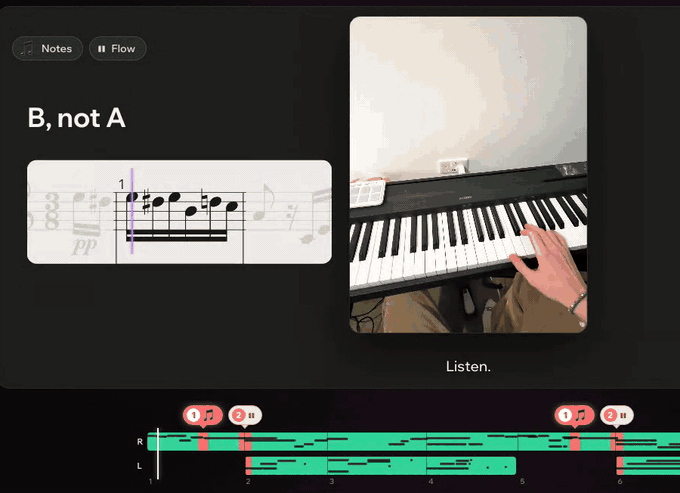

# Museverse Teacher

Try it: https://museverse-meta-teacher.vercel.app (the password is in our submission).

Film yourself playing the piano, upload the video, and Muse, a piano teacher, gives you a lesson on what to fix: the
score is the progress bar, each fix is explained, shown played correctly and turned into an exercise, and the week ahead
is planned in practice minutes.

This repository holds the page, the server's API, the code that calls Meta's models and how the recorded demonstrations
are protected. The measuring pipeline (reading the video, hearing the notes, lining them up with the score, judging them)
runs on our server behind the API and is not part of it: see ARCHITECTURE.md.

- `web/front/`: the page as the live site serves it (plain JavaScript, HTML and CSS). The server builds it at start-up
  (`web/front.py`); the build script, the 3D models' and the piano's bundles (`ghost-assets.js`, `piano-assets.js`), the
  cover art and the textures are not in this repository. `web/static/`: the How it works page, the notices and the font.
- `web/server.py`: the API (FastAPI); `web/ghost_guard.py`: the recorded demonstration's cuts, capped and encrypted.
- `web/meta_api.py`: the calls to Meta's Model API for SAM 3.1 (video and images) and Muse Voice Transcribe, with each
  call's cost; `web/framing.py`: SAM 3.1 on a few frames first, to check the hands can be placed on the keys.
- `web/wonder.py`: Muse Wonder judges which fixes to teach and in what order, answering to a JSON schema, and
  `validate()` holds its answer to the evidence. `web/voice.py`: the Muse text calls (Muse Wonder, then Muse Spark), the
  fact gate every line a model writes must pass (`facts_check`, `check`, `validate_answer`) and the fixed wording that
  stands when a line fails. `web/practice_plan.py` and `web/framing_tip.py`: the practice plan and the filming tip.
  The prompts and teaching texts in these files are replaced by a marker; their shape is as it runs.
- `deploy/modal/`: how the server runs on Modal.

The code is licensed under the Apache License 2.0 (LICENSE). The scores, the recorded performances, the lessons, the
prompts' texts and the teaching know-how are not in this repository and are not licensed. The third-party files under
web/static/vendor/ and web/static/models/hands/ keep their own licences, which sit beside them.
